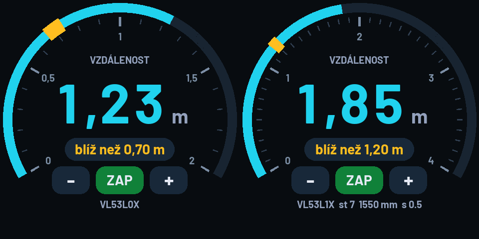

# DistanceRing

Laserový měřič vzdálenosti s kulatým displejem. Arduino firmware pro
Waveshare ESP32-S3-Touch-LCD-2.1 a laserový dálkoměr VL53L1X nebo VL53L0X.

## Co to dělá

- Uprostřed displeje ukazuje změřenou vzdálenost velkým písmem.
- Po obvodu běží stupnice s prstencem, který se plní podle vzdálenosti. Pro VL53L1X má rozsah 0–4 m, pro VL53L0X 0–2 m.
- Ozve se vestavěný bzučák, když je předmět **blíž** nebo naopak **dál** než nastavená mez. Mez je na stupnici vyznačená žlutou značkou.
- Upozornění se nastavuje dotykem: `−` a `+` posouvají mez po 5 cm, `ZAP`/`VYP` ho zapíná a vypíná. Klepnutím na „blíž než / dál než“ se přepíná směr.
- Nastavení přežije vypnutí, ukládá se do paměti desky.
- Pozná sám, který ze dvou senzorů je připojený, a přizpůsobí mu stupnici.
- Filtruje nespolehlivá měření. Když senzor nic nevidí, ukáže „MIMO DOSAH“, a když je odraz slabý, ukáže odhad s poznámkou „SLABÝ ODRAZ“.

## Hardware

| Díl | Poznámka |
| --- | --- |
| [Waveshare ESP32-S3-Touch-LCD-2.1](https://www.laskakit.cz/waveshare-esp32-s3-round-2-1--480--480-ips-touch-wifi-modul/) | kulatý dotykový displej 480 × 480 s ESP32-S3 a bzučákem |
| [VL53L1X](https://www.laskakit.cz/laserovy-senzor-vzdalenosti-vl53l1x-i2c/) **nebo** [VL53L0X](https://www.laskakit.cz/laserovy-senzor-vzdalenosti-vl53l1x-i2c-2/) | laserový dálkoměr, dosah 4 m, resp. 2 m |

Senzor se připojí na I2C konektor desky:

| Senzor | Deska |
| --- | --- |
| VIN | 3V3 |
| GND | GND |
| SDA | GPIO15 |
| SCL | GPIO7 |

Ze senzoru před použitím sundej ochrannou fólii. Udávaný dosah platí ve tmě a na světlý povrch, na přímém slunci je výrazně kratší.

## Instalace

1. V Arduino IDE nainstaluj desku **esp32 by Espressif** (verze 3.0.0 nebo novější) a knihovny **VL53L1X** a **VL53L0X** od Pololu. Potřeba jsou obě.
2. Otevři `DistanceRing.ino` a nastav desku **ESP32S3 Dev Module**, **OPI PSRAM**, **16MB Flash** a **Huge APP**.
3. Nahraj firmware přes USB-C port označený **UART**.

Žádná grafická knihovna není potřeba, displej se vykresluje vlastní vrstvou.

## Zdroj

Ovladače displeje, dotyku a GPIO expandéru vycházejí z projektu [CooLajz/waveshare-hodiny](https://github.com/CooLajz/waveshare-hodiny) (MIT). Písmo Barlow je pod licencí SIL OFL 1.1.
